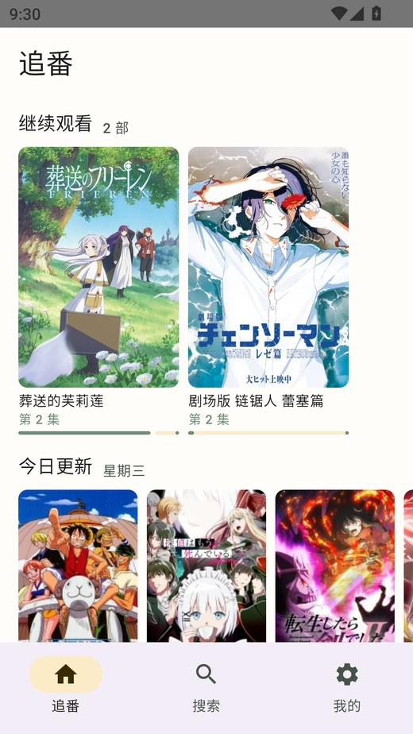
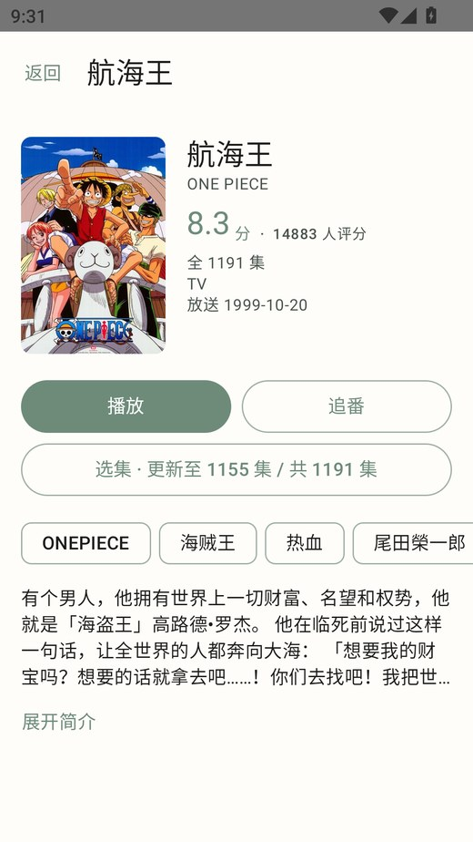
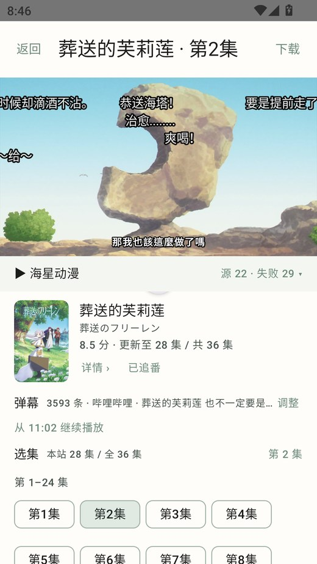
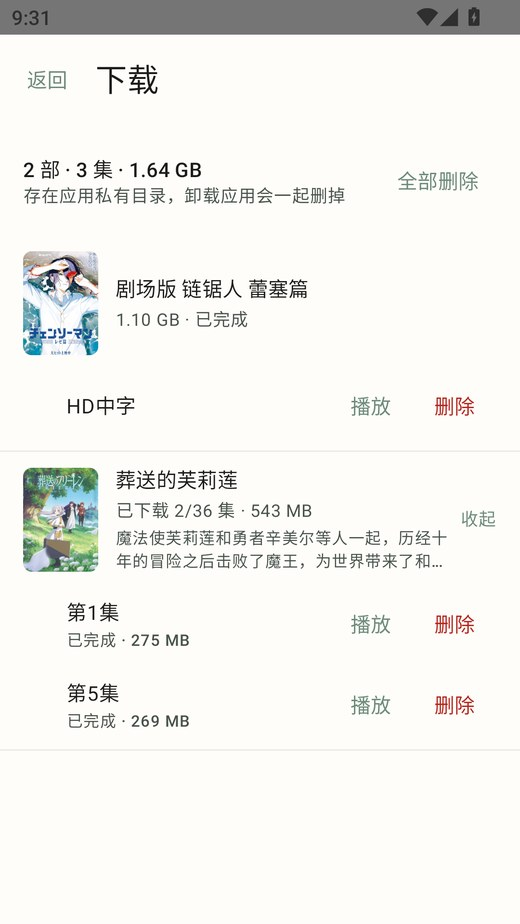
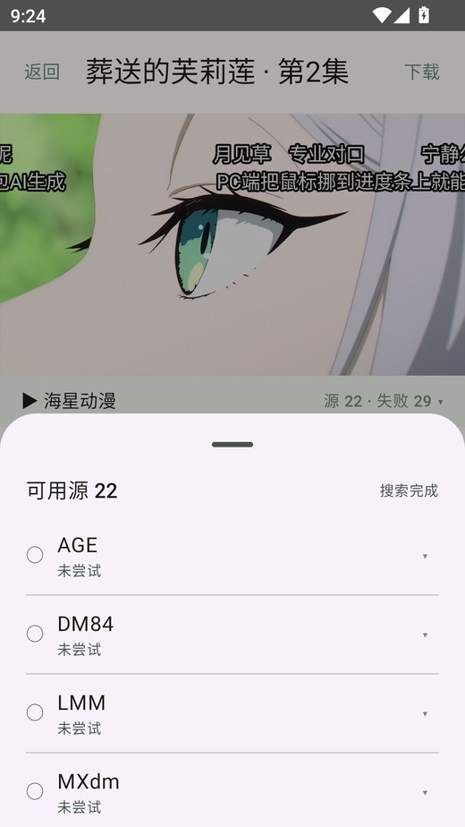

# 木漏 Komo

Android 追番客户端。**索引 → 详情 → 播放**，带 B 站弹幕、离线下载和一条你自己的规则链。

> 应用**不内置任何片源**。内容来源由用户导入规则自行配置，本项目只做索引、播放器与弹幕渲染。
> 仅供个人学习研究，请勿用于任何商业用途。

<p align="center">
  
  
  
  
</p>
<p align="center">
  
</p>

## 功能

**发现**

- 追番首页：继续观看（带进度条）、今日更新、本季新番
- 季度番剧表：按「2026 秋」这样的季度浏览整季全量，滚到底自动翻页
- 搜索：本地索引 + Bangumi 在线搜索，带历史记录

**详情**

- 评分、简介、标签、放送日期、集数与更新进度
- 角色与声优（Bangumi `/characters`）
- 下一集播出时间（AniList `nextAiringEpisode`，只在标题能严格对上时才显示）

**播放**

- Media3 + HLS，带 Referer/UA/Cookie
- 手势：单击显隐控制条、双击播放暂停、左右拖进度、右侧上下拖音量、左侧上下拖亮度
- 0.75×–2× 倍速、全屏、选集、自动连播、记忆上次的源与进度
- 源面板：可用源 / 失败源分组，失败原因就地显示；403 挑战走 WebView 过一次人机验证

**集数与门禁（防播错集）**

播放前先和官方进度对账，不猜：

| 状态 | 判据 | 表现 |
|---|---|---|
| 可播 | 该源线路里确有这一集 | 正常播放 |
| 源未更新 | 官方已播，源最多到第 N 集 | 弹卡片：先看第 N 集 / 换源 / 提醒我 |
| 还没播出 | 官方进度都不够 | 幽灵格，点了提示未播出 |

「提醒我」把 (番, 集, 源) 记进本地，WorkManager 每 30 分钟探一次，出现目标集数就发通知，点通知直达播放。

**离线下载**

- media3 `DownloadManager`，HLS 与渐进式都支持，断点续传、暂停、继续
- 下载时把番剧简介和封面一起落盘，断网时详情页、下载页仍然有内容
- 下载页按番剧分组：单集作品直接铺开，多集显示「已下载 2/36 集」可展开

**弹幕**

- 数据来自哔哩哔哩公开接口（不需要登录、不需要大会员）
- 按剧名 + 季数标记严格匹配，宁可没有也不挂错季
- 外观可调：透明度、字号、显示区域、速度，以及 ±秒级时间轴对齐（各家片源片头长短不一）
- 按播放位置逐帧绘制，不经过 ViewModel，不引起整页重组

**其他**

- 源体检：批量测所有规则的可用性（浅检只搜索、深检连带取线路），可导出报告
- 主题：浅色 / 暗色 / 跟随系统
- 规则从文件、剪贴板、规则索引仓库三条路导入，支持 Kazumi 格式与 CSS1 规则包

## 模块

```
app/                Android 客户端（Compose + Media3 + WebView 嗅探）
core/rules/         纯 JVM 规则引擎：schema、受限 JSONPath、XPath、两条抓取链路
core/sniff/         纯 JVM 嗅探逻辑：候选分类/去噪/排序、m3u8 解析、JS 注入脚本
core/catalog/       纯 JVM 番剧索引：Bangumi 客户端与模型
core/danmaku/       纯 JVM 弹幕源：wbi 签名、protobuf 解析、剧集匹配
tools/rule-cli/     规则自检 / 搜索 / 健康巡检命令行
tools/mock-site/    本地 mock 站，用于端到端回归（不碰真实站点）
docs/               调研、方案与设计说明
```

`core/*` 不依赖 Android，单测可以在 JVM 上直接跑；Android 侧只做很薄的胶水（WebView、播放器、UI）。

> 纯 JVM 库不代表能直接用：JDK 上有的 API 未必在 Android 上存在（例如 `URLEncoder.encode(String, Charset)`
> 需要 API 33）。`AndroidApiGuardTest` 会静态扫描这类用法，防止「单测全绿、真机崩溃」。

## 构建

要求 JDK 21、Android SDK 34（`compileSdk 34` / `minSdk 26`）。

```bash
./gradlew test                 # core 模块单测
./gradlew :app:assembleDebug   # 产出 app/build/outputs/apk/debug/app-debug.apk
./gradlew :app:assembleRelease # 需要在 app/ 下自备签名密钥（见下）
```

签名配置不写死在仓库里：在 `app/build.gradle.kts` 里读取 `local.properties` 或环境变量，
自备一份 keystore 即可。**正式包与调试包签名不同，切换时必须先卸载**，否则会提示签名冲突。

`./gradlew` 首次运行需要联网下载 Gradle 发行包；网络受限时可以用本机 Gradle 执行同名任务。

## 使用

### 导入规则

**应用不内置任何规则**。规则平均两个月就失效一半，内置等于出厂即过期；这也决定了应用的性质——
它只是浏览器和播放器，内容来源由用户配置。

导入路径：

1. **从文件导入**：`我的 → 规则 → 从文件导入`，选一份 JSON 或 NDJSON
2. **从剪贴板导入**：单条规则 JSON、JSON 数组，或整份 Kazumi Hub 的 `css1.json`
3. **规则索引**：从公开仓库拉 `index.json`，逐条下载解析（多镜像重试）

规则落盘到 `filesDir/rules.ndjson`，重启仍在。

### 番剧索引

默认取 Bangumi 公开接口，缓存优先：先读本地缓存渲染，再后台刷新，刷新失败不清空缓存。

`api.bgm.tv` 在部分网络下会被 DNS 污染，所以「我的 → 高级」留了三个逃生口：索引地址（可填反代域名）、
封面地址前缀、测试连接（只探测不写缓存，直接告诉你成败、耗时、条目数和实际 URL）。

### 弹幕

不需要账号。播放时按「番剧原名 / 中文名」检索 B 站番剧库，拿到对应集数后拉弹幕。
匹配不上就什么都不显示，不会拿别的季糊弄。

调试期间可以用播放页「重新匹配」手动触发；片头对不上时用「时间轴」把弹幕整体前后挪。

## 技术笔记

**规则格式是 Kazumi 的超集**。Kazumi 字段原样保留，自定义能力放 `x-` 前缀，导出时剥掉即可回退成合法规则。
几条必须照抄、不能"顺手优化"的语义：

1. `muliSources` 的拼写是错的（multi → muli），改了就不兼容
2. `@roadIndex` / `@episodeIndex` 从 0 开始，`@roadNumber` / `@episodeNumber` 从 1 开始
3. `sourceTemplate` 用朴素替换（`/GV@source/`），URL/body 模板用带负向后瞻的正则（避免误伤 `a@b.com`）
4. `//` 在条目上下文要相对化成 `.//`——74/86 条真实规则这么写，按 XPath 1.0 字面语义会命中文档第一个节点
5. `delimited` 的字段分隔符叫 `fieldSeparator`

**CSS1 兼容靠翻译，不靠第二个执行器**：CSS 选择器在导入时翻译成 XPath，只覆盖 CSS1 实际用到的子集，
遇到 `:has()` 这类直接报错跳过，不静默降级。

**季数匹配**：剧名相似度不够，「重启」「第二季」「剧场版」这类版本标记必须双向一致，
否则「魔法少女育成计划 restart」会匹配到 2016 年的老版——这类错配比"没有弹幕"难查得多。

**下载不设 `customCacheKey`**：media3 对 HLS（type 2）禁止自定义 key，用默认 `CacheKeyFactory`（key = uri），
播放端 `CacheDataSource` 用同一个 uri 做 key，正好对上。

**已下载的集才挂缓存**：在线播放刻意不写缓存，避免"看一集塞几百 MB"。

**集数门禁**：`matchEpisodeIndex` 找不到对应集时返回 `null` 而不是钳到最后一集——静默播错集是最难发现的 bug。

## 已知限制

- 只在 MuMu 12（Android 12L / API 32）和一台真机上验证过，未覆盖低端设备与全部 ROM
- 弹幕只有 B 站一个源，B 站没买的番（部分国漫、欧美动画）没有弹幕
- 冷门番、冷门源搜不到时只能换源，应用不做站点推荐
- WebView 嗅探在部分 ROM 上会被节流；MSE（blob）页面目前只识别并提示
- 下载存在应用私有目录，卸载应用会一起删掉

## 第三方数据与服务

| 用途 | 来源 |
|---|---|
| 番剧索引、详情、季度表、角色声优 | [Bangumi 番组计划](https://bgm.tv) 公开 API |
| 下一集播出时间 | [AniList](https://anilist.co) GraphQL |
| 弹幕 | 哔哩哔哩公开弹幕接口（未登录、只读） |
| 播放地址 | 用户导入规则所指向的第三方站点 |

本项目与上述服务均无隶属关系，也不代理、转存、再分发它们的任何内容。

## 免责声明

本项目仅用于学习 Android 开发（Compose、Media3、WebView 嗅探、规则引擎），不提供、不托管、不索引任何视频内容。
所有播放地址均来自用户自行配置的规则，与本项目无关。请勿用于任何侵犯版权的用途。

## 许可

[Apache License 2.0](LICENSE)
